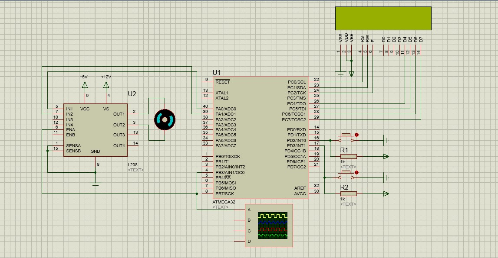
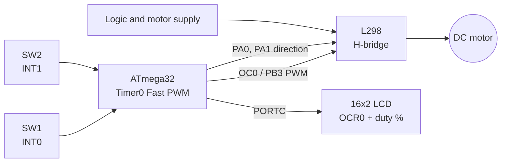
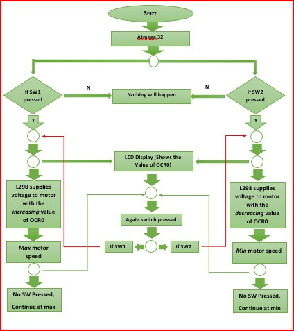
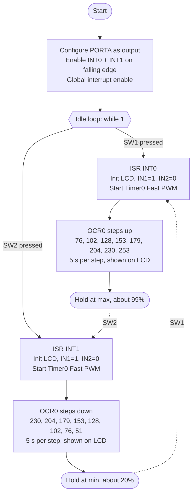
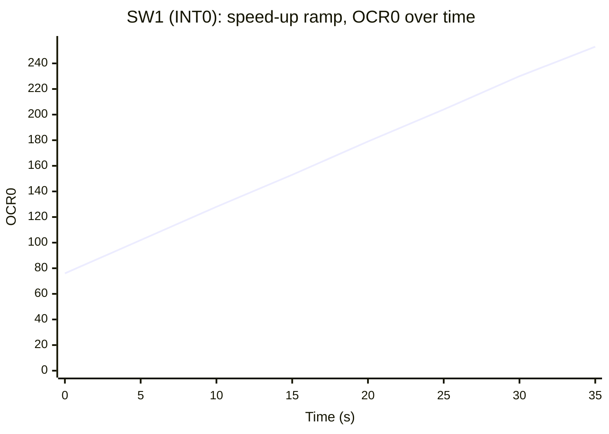
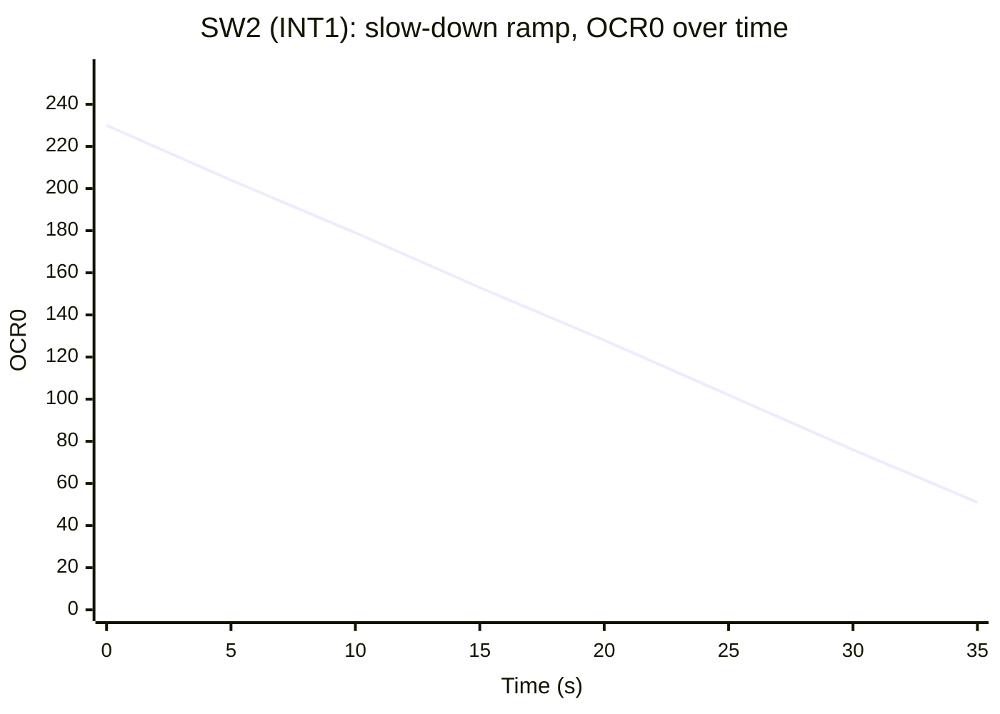

# DC Motor Speed Controller using ATmega32 and L298 Motor Driver (2019)

A push-button controlled DC motor speed controller. An **ATmega32** generates a PWM signal with **Timer0 (Fast PWM)**; an **L298** H-bridge driver applies that PWM to the motor. A 16x2 **LCD** shows the current `OCR0` value and duty cycle. The design was built and simulated in **Proteus** and programmed with **CodeVisionAVR**.

This was a mini project for **EEE366, Microprocessor Laboratory** (Section 02, Spring 2019).

**Team:** Tanjil Ahmed, Md. Rezuwan Hasan, Abu Yousha MD Abdullah



## Table of contents
1. [Features](#features)
2. [Repository structure](#repository-structure)
3. [Hardware](#hardware)
4. [How it works](#how-it-works)
5. [Results](#results)
6. [Firmware](#firmware)
7. [Build and simulate](#build-and-simulate)
8. [Project documents](#project-documents)
9. [Notes and possible improvements](#notes-and-possible-improvements)

## Features
- Speed control by PWM duty cycle using Timer0 in Fast PWM mode (non-inverting, output on `OC0`/PB3).
- Two push buttons on external interrupts:
  - **SW1 (INT0)** ramps speed **up**, 30% to 99%.
  - **SW2 (INT1)** ramps speed **down**, 90% to 20%.
- 16x2 character LCD shows the `OCR0` value and the duty cycle at each step.
- Direction fixed by L298 inputs `IN1 = 1`, `IN2 = 0`.
- Oscilloscope probe on the PWM pin in the Proteus design for viewing the waveform.
- The ramps can be interrupted by the other button (or restarted by the same one) while a ramp is running.

## Repository structure
```
.
├── README.md
├── src/
│   └── dc_motor_speed_control.c        # CodeVisionAVR firmware source
├── firmware/
│   ├── dc_motor_speed_control.hex      # Pre-built hex for the ATmega32
│   └── codevision/                     # CodeVisionAVR project settings (reference)
│       ├── dc_motor_speed_control.prj
│       └── dc_motor_speed_control.cproj
├── simulation/
│   └── dc_motor_speed_control.pdsprj   # Proteus project
└── docs/
    ├── images/
    │   ├── schematic-proteus.jpg       # Final Proteus circuit
    │   ├── schematic-concept-draft.png # Early draft from the concept paper
    │   └── flowchart.jpg               # Program flow chart
    ├── report/
    │   ├── Report.docx                 # Final project report
    │   └── Concept-Paper.docx          # Initial project proposal
    ├── presentation/
    │   └── Presentation.pptx           # Project presentation
    └── course/
        └── Mini-Project-Guidelines.pdf # Course mini-project guidelines
```

## Hardware

| Component | Role |
|---|---|
| ATmega32 (U1) | Controller; Timer0 generates the PWM (16 MHz clock setting in the project) |
| L298 (U2) | Dual H-bridge motor driver |
| 6 V DC motor | Load, on L298 `OUT1`/`OUT2` |
| 16x2 LCD (HD44780) | Shows `OCR0` and duty cycle (4-bit mode on PORTC) |
| 2 x push buttons + resistors (R1, R2) | SW1 on `PD2/INT0`, SW2 on `PD3/INT1` |
| +5 V / +12 V supplies | Logic (`VCC`) and motor (`VS`) supply for the L298 in the simulation |
| Oscilloscope (Proteus only) | Observes the duty cycle and its change with `OCR0` |

The report lists the physical build as an AVR kit (ATmega32, LCD and push buttons), a 6 V DC motor, a 5 V adapter, the L298 driver and jumper wires.

### Pin map (from the code, project settings and schematic)

| ATmega32 pin | Signal | Connected to |
|---|---|---|
| PA0 | Direction | L298 `IN1` (driven high) |
| PA1 | Direction | L298 `IN2` (driven low) |
| PB3 / `OC0` | Timer0 PWM output | L298 enable (speed) and scope probe |
| PD2 / `INT0` | SW1 | Speed up (falling edge) |
| PD3 / `INT1` | SW2 | Speed down (falling edge) |
| PC0, PC1, PC2 | LCD `RS`, `RW`, `E` | 16x2 LCD |
| PC4-PC7 | LCD `D4`-`D7` | 16x2 LCD |

> Check the PWM-to-enable routing against the schematic image. The code configures PB3 (`OC0`) as the PWM output, so that is the pin that must drive the L298 `ENA` input.

## How it works

### System block diagram


### Program flow (original chart)


### Program flow (as implemented)


### Timer0 configuration
`TCCR0 = (1<<WGM00)|(1<<WGM01)|(1<<COM01)|(1<<CS02)|(1<<CS00)`

| Setting | Value | Meaning |
|---|---|---|
| WGM01:00 | `11` | Fast PWM |
| COM01:00 | `10` | Non-inverting: `OC0` is set at BOTTOM and cleared on compare match |
| CS02:00 | `101` | Prescaler = 1024 |

Duty cycle is `OCR0 / 256`. With the 16 MHz clock set in the CodeVision project, the PWM frequency is `16 MHz / (1024 x 256)` = about **61 Hz**.

## Results

### OCR0 steps and duty cycle
Values set in the firmware (`duty = OCR0 / 256`). `OCR0` can only hold an integer, so most steps are slightly below the target.

| Step | OCR0 | Target duty | Exact duty (OCR0/256) | Ideal OCR0 |
|---:|---:|---:|---:|---:|
| 1 | 51 | 20% | 19.9% | 51.2 |
| 2 | 76 | 30% | 29.7% | 76.8 |
| 3 | 102 | 40% | 39.8% | 102.4 |
| 4 | 128 | 50% | 50.0% | 128.0 |
| 5 | 153 | 60% | 59.8% | 153.6 |
| 6 | 179 | 70% | 69.9% | 179.2 |
| 7 | 204 | 80% | 79.7% | 204.8 |
| 8 | 230 | 90% | 89.8% | 230.4 |
| 9 | 253 | 99% | 98.8% | 253.4 |

The two ramps (each step lasts 5 s):





### Effective motor voltage
As described in the report, the average voltage applied to the motor is `duty x supply voltage`. With a 5 V supply:

| Duty cycle | OCR0 | Average motor voltage |
|---:|---:|---:|
| 30% | 76 | about 1.5 V |
| 50% | 128 | 2.5 V |
| 99% | 253 | about 4.95 V |

### Observations from testing
From the report and presentation:
- The motor did **not** start from rest at **25% duty or below**. The duty is too low to overcome the motor's inertia.
- If the motor is first run at a higher duty and then brought down to 25%, or even 20%, the shaft keeps turning slowly.
- Below about 20% duty the shaft does not rotate.
- At the end of each ramp the final `OCR0` is held (maximum or minimum speed) until a button is pressed again.

The PWM waveform, LCD output and motor rotation are viewable in the Proteus simulation (oscilloscope on `OC0`). Open `simulation/dc_motor_speed_control.pdsprj` in Proteus to reproduce it.

## Firmware
Source: [src/dc_motor_speed_control.c](src/dc_motor_speed_control.c). Pre-built hex: [firmware/dc_motor_speed_control.hex](firmware/dc_motor_speed_control.hex).

- **Toolchain:** CodeVisionAVR (uses `<mega32.h>`, `<delay.h>`, `<alcd.h>`).
- **`main()`:** sets PORTA as output, enables INT0/INT1 on the falling edge, enables interrupts, then idles.
- **`ext_int0_isr()`:** starts PWM and steps `OCR0` from 76 up to 253.
- **`ext_int1_isr()`:** starts PWM and steps `OCR0` from 230 down to 51.

## Build and simulate
1. In CodeVisionAVR, create a project for **ATmega32** with a **16 MHz** clock. The settings used originally are in [firmware/codevision/](firmware/codevision/).
2. Configure the alphanumeric LCD: 16 characters per line, `RS`=PC0, `RD`=PC1, `EN`=PC2, `D4`-`D7`=PC4-PC7.
3. Add `src/dc_motor_speed_control.c`, then compile to generate the `.hex` (or use the pre-built one in `firmware/`).
4. Open `simulation/dc_motor_speed_control.pdsprj` in Proteus (or build the circuit from `docs/images/schematic-proteus.jpg`) and load the `.hex` into the ATmega32.
5. Run the simulation. Press SW1 to ramp the speed up and SW2 to ramp it down.

> The files in `firmware/codevision/` and the Proteus project were saved with absolute paths from the original machine, so they may need their file paths re-pointed when opened elsewhere.

## Project documents
- [Final report](docs/report/Report.docx): design methodology, flow chart, code, results and conclusions.
- [Concept paper](docs/report/Concept-Paper.docx): initial proposal and early schematic ([draft schematic image](docs/images/schematic-concept-draft.png)).
- [Presentation](docs/presentation/Presentation.pptx): slides used for the project presentation.
- [Mini project guidelines](docs/course/Mini-Project-Guidelines.pdf): course requirements.

The report and presentation describe earlier ramp ranges (40% to 99% up and 90% to 30% down). The source in this repository is the final version: 30% to 99% up and 90% to 20% down.

## Notes and possible improvements
- The ISRs run for about 35 s with interrupts re-enabled (`sei`), call `lcd_init` and use blocking `delay_ms`. Nesting is intentional (the report notes a ramp can be interrupted by either button), but a more robust structure is to set a flag in the ISR and run the ramp in `main()`.
- Each `lcd_puts` writes 26 characters on a 16-character display, and the LCD is not cleared between steps.
- A prescaler of 1024 gives a low PWM frequency (about 61 Hz), which can cause audible or visible jitter on a real motor. A smaller prescaler (for example 64 or 8) would be smoother.
- No license file is included yet. Add one (for example MIT) if you want others to reuse the code.
